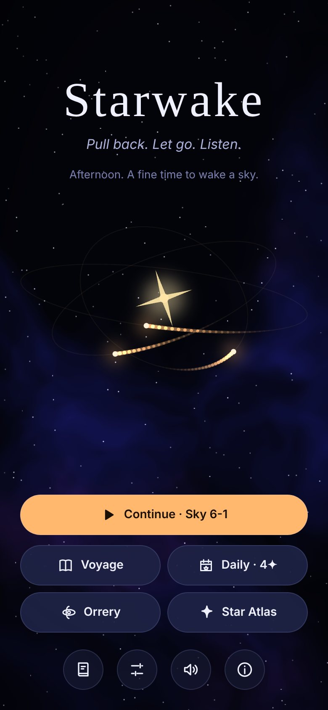
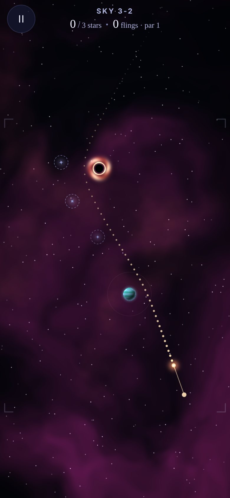
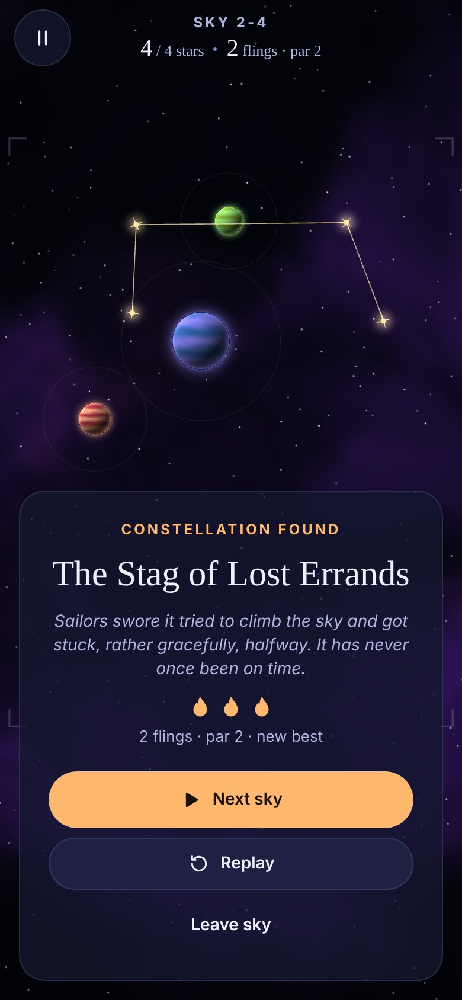
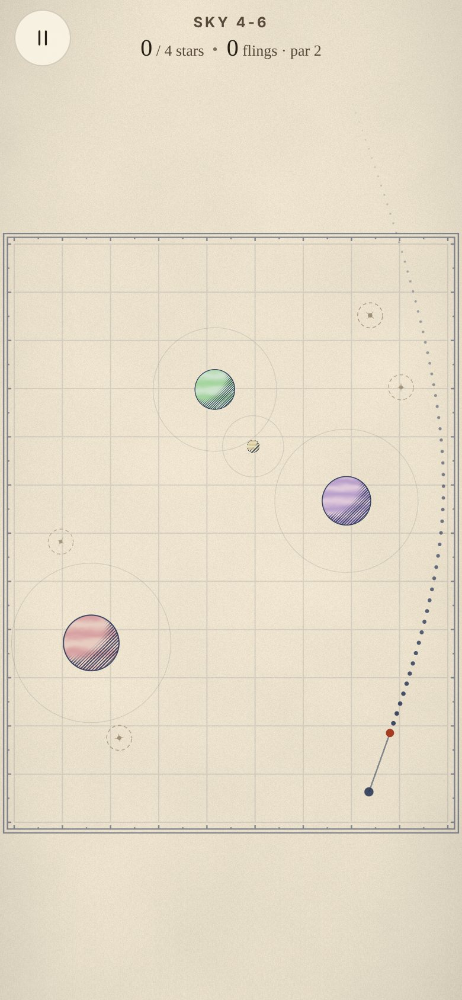
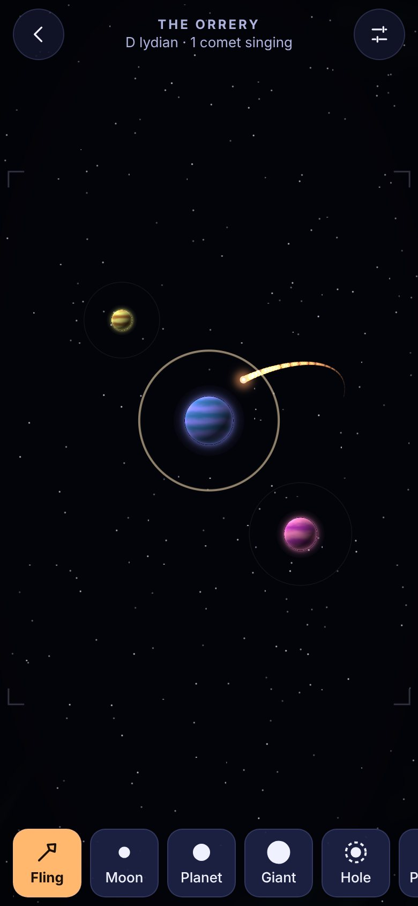
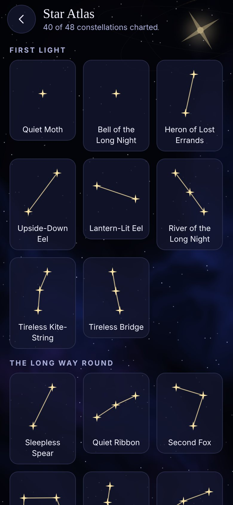

# Starwake

**A gravity-slingshot puzzle where every orbit is a song.**

The sky has gone quiet; the stars have fallen asleep. You are Ember, a small comet, and your guide is the
Lamplighter — the last star still burning, a little theatrical after a billion years of talking to no one.
Pull back, let go, and bend your path around planets to wake the sleeping stars. Every planet hums a note in
the sky's musical mode, so the path you fly *is* a melody. Wake a whole sky and its stars join into a
constellation with a name and a myth of its own.

One TypeScript codebase, running on **iOS and Android through Expo Go** (and in a browser). Fully offline:
no accounts, no servers, no API keys, and no asset packs — every pixel, every note and even the app icon is
generated by code.

<p align="center">
  
  
  
</p>
<p align="center">
  
  
  
</p>

*Screenshots are from the web build, which renders with the same Skia code as the phone apps.*

---

## Your first 60 seconds

1. **Tap _Begin_.** You land in the first sky with one sleeping star. A ghostly finger shows the gesture:
   **drag anywhere, pull back, let go.** The dotted line shows where you'll go; stars it will wake glow gold.
2. **Wake the star.** Hear the chime, feel the tap, watch the constellation draw itself and get named.
3. **Tap _Next sky_** a couple of times. A planet appears: pull, aim *past* it, and listen to it ring as you
   slingshot around. Faster passes ring louder.
4. **Back on the title, open the _Orrery_.** A comet is already circling and singing. Tap
   **Orrery menu → Gift an orbit** a few times and you have a little piece of generative music. Drag planets
   around while they play.
5. **Settings → Sky → Almanac** to see the whole game redrawn as an antique ink-on-parchment star chart.

Hidden things exist. (Try being persistent with the title.)

---

## What's in it

| | |
|---|---|
| **Voyage** | 48 hand-tuned, machine-verified skies across 6 chapters, each introducing one idea — gravity, slingshots, black holes, orbiting moons, repulsors and wormholes — and each in its own musical mode (Ionian, Lydian, Aeolian, Dorian, Mixolydian, Phrygian). Golf-style scoring: stars stay awake between flings; finish at or under par for three embers, in one fling for a *Grace* badge. |
| **Daily Sky** | A new puzzle every day, generated on the phone from the date, identical for everyone. Streaks, and a shareable result (`✦✦✧  3 flings (par 2)`). |
| **Orrery** | A sandbox instrument. Place moons, planets, giants, black holes and repulsors; fling up to six comets; stable orbits become repeating phrases. Pick the key and mode, save three layouts, share them as short codes. Shake the phone to scatter the sky. |
| **Star Atlas** | Every constellation you've woken, drawn as a little chart with its name and myth. |
| **Logbook** | Lifetime stats (leagues travelled, closest black-hole pass, most orbits in one flight…) and 19 achievements, some secret. |
| **Two art directions** | *Midnight* (dark mode): luminous nebulae, bloom, and black holes that visibly bend the background. *Almanac* (light mode): parchment, hatched planets, ruled chart borders — and the grid lines bend around black holes. Follows the system setting, or pick one. |
| **Comets** | Five unlockable comet skins, including a hue-cycling one hidden behind a secret. |

---

## Running it

You need **Node.js 20 or newer** (22 recommended) and npm.

```bash
git clone https://github.com/vierajesnel/Opus-Test-App.git starwake
cd starwake
npm install
```

`npm install` also copies Skia's WebAssembly file into `public/` (only used by the web build).

### On a physical phone with Expo Go (easiest: Android and iPhone)

1. Install **Expo Go** from the Play Store or App Store. Starwake targets **Expo SDK 58**, which is what the
   current store version of Expo Go runs.
2. Start the dev server:
   ```bash
   npx expo start
   ```
3. Scan the QR code shown in the terminal:
   - **Android:** open Expo Go and tap *Scan QR code*.
   - **iPhone:** open the Camera app and tap the banner that appears.
4. Your phone and computer must be on the same Wi-Fi. If your network blocks that (corporate or hotel Wi-Fi),
   use a tunnel instead: `npx expo start --tunnel`.

Turn the sound up, and on iPhone make sure the ring/silent switch is on ring: Starwake respects silent mode on
both platforms.

### Android emulator

1. Install [Android Studio](https://developer.android.com/studio) and create a device in *Device Manager*.
2. Start the emulator, then run `npx expo start` and press **`a`** (or run `npm run android`). Expo Go is
   installed into the emulator automatically.

### iOS Simulator (macOS only)

1. Install Xcode from the Mac App Store and open it once to install the simulator components.
2. Run `npx expo start` and press **`i`** (or run `npm run ios`).

### In a browser

```bash
npx expo start --web
```

The web build is a bonus (it's how the screenshots above were taken); haptics and tilt parallax don't apply there.

### Building installable apps (EAS Build)

`eas.json` defines two profiles: **preview** (an installable APK / internal iOS build) and **production**
(store builds).

```bash
npx eas-cli@latest login                                   # free Expo account
npx eas-cli@latest build --platform android --profile preview   # → an .apk you can sideload
npx eas-cli@latest build --platform ios --profile preview       # → internal build (needs an Apple Developer account
                                                                 #   and your device registered with `eas device:create`)
npx eas-cli@latest build --platform all --profile production    # → Play Store .aab and App Store .ipa
npx eas-cli@latest submit --platform ios                        # → TestFlight / App Store Connect
```

The first build asks to create a project ID and manage signing credentials for you. The bundle identifier
and Android package are both `app.starwake.game`; change them in `app.json` before publishing your own copy.

**Local builds** without EAS are also possible: `npx expo run:android` (needs Android Studio) or
`npx expo run:ios` (needs Xcode). These generate the native `android/` and `ios/` folders, which are
git-ignored because Expo regenerates them from `app.json`.

---

## Project structure

```
src/
  engine/       Deterministic physics. Pure functions, all Reanimated worklets.
  gen/          Seeded RNG, constructive level generator, launch-space solver, Daily Sky.
  music/        Music theory, DSP primitives (filters, reverb, WAV encoder), synthesised instruments.
  audio/        Playback: a render queue + mix ("director"), with native (expo-audio) and web backends.
  render/       Skia: SkSL shaders, the sky canvas, the ambient menu sky, UI-thread drawing worklets.
  game/         Playing a sky: the UI-thread simulation hook, gestures, HUD/overlays, Orrery logic.
  content/      Chapters, the 48 generated levels (JSON), achievements, the Lamplighter's lines, myths.
  state/        Save schema + sanitiser, checksummed persistence, progress rules, a tiny store.
  screens/      Title, Voyage, Level, Daily, Orrery, Atlas, Logbook, Settings, About.
  nav/          A small stack navigator with themed transitions and back-button interception.
  ui/           Design system: tokens, theme provider, text, controls, icons, toasts, haptics.
scripts/
  build-levels.ts    Generates, solves and verifies the Voyage → src/content/levels.generated.json
  generate-icons.ts  Draws the app icon, adaptive icons and splash with CanvasKit → assets/
```

**Architecture in one paragraph.** The comet simulation runs on the **UI thread** as Reanimated worklets
(`src/game/worklets/sky.ts`), driven by a frame callback. Gestures are UI-thread worklets too, so aiming,
the trajectory preview and the flight itself never wait on JavaScript. Skia draws the static parts (backdrop
texture, planet and black-hole shaders) declaratively, and records the fast-changing parts (trail, particles,
guide, stars) into **one `SkPicture` per frame**. The JS thread only hears about *events* — a star woke, a
planet sang, the flight ended — which it turns into sound, haptics, saved progress and the Lamplighter's
commentary. App state lives in a 40-line external store; the save is the single source of truth.

---

## Technical highlights

### 1. A symplectic physics engine that runs on the UI thread
`src/engine/physics.ts` integrates a softened n-body field with **velocity Verlet at a fixed 240 Hz** step,
decoupled from frame rate by an accumulator. Verlet is symplectic: orbits don't leak energy, which matters
when the Orrery lets a comet loop a planet for minutes. A test proves it holds a circular orbit within 0.5%
for twenty revolutions while explicit Euler drifts more than 50× further. The About screen shows the two
integrators racing live.

Code that runs on the UI thread has a failure mode no ordinary test sees: calling a non-worklet function
there crashes on device, but works fine in Jest and on the web. And because the worklet compiler snapshots
a function's dependencies at definition time, a worklet calling a function declared *later* in the same file
gets `undefined`. **`worklet-guard.test.ts` parses every UI-thread module with Babel** and fails the build
on either mistake. It caught a real instance of the second one during development.

### 2. Levels that are solvable by construction
Random puzzle generation usually means "generate, then hope a solution exists". Starwake's generator
(`src/gen/generator.ts`) inverts that: it lays out gravity, **flies a comet through it, and hangs stars
along the stretches of the path that only exist because gravity bent it**. Every sky therefore has a
solution, and each constructed fling must also pass a **robustness check**: a ±2° / ±4% neighbourhood of
launches must still work, so the solution is findable by a thumb rather than a floating-point coincidence.

A **solver** (`src/gen/solver.ts`) then samples launch space (180 angles × 16 powers per fling) to look
for shorter solutions (par only drops if the shorter solution is just as forgiving) and to measure
difficulty as the rarity of winning launches. The build script generates three candidates per slot and keeps
the one closest to the chapter's difficulty ramp. The result: 48 skies, 179 stars, all re-verified in the test
suite. The hint button shows the next shot of that verified, forgiving solution.

The generator is written as a JavaScript *generator function* that yields between attempts, so the build
script runs it flat out while the phone runs the Daily Sky in 10 ms slices without freezing anything.

### 3. Every sound is synthesised
There are no audio files in the repository. `src/music/` renders:
- **Planet bells:** two-operator FM synthesis with an inharmonic 3.5 ratio and a decaying modulation index.
- **Star chimes:** additive partials at the modes of a struck bar (1 : 2.756 : 5.404 : 8.933), each decaying
  at its own rate.
- **Ambient pads:** a seamless loop. Every partial and every LFO completes a *whole number of cycles*
  per loop (f′ = round(f·L)/L, an inaudible error under 0.05 Hz), and the reverb is primed with a full pass,
  so there is no seam to hear. A test checks the loop point.
- **Effects** from filtered noise, glides and FM: launch whoosh, crash, black-hole gulp, wormhole hop.

Each sky has a key and a mode; planets sing scale degrees (bigger planets lower), and each star you wake
rings the next chord tone, so the harmony builds as the sky wakes. Dark skies end on a Picardy third. Clips
are rendered lazily in priority order, encoded to WAV in JavaScript, cached on disk (`expo-file-system`),
and played through small voice pools (`expo-audio`). The web uses Web Audio directly.

### 4. Constellations from geometry
Finished skies are joined by a **minimum spanning tree** (Prim's algorithm), which is how human sky-figures
tend to look. **Principal-component analysis** of the stars tells long figures (rivers, herons, spears)
from broad ones (whales, owls, teapots), and a small seeded grammar writes the myth. It even uses the
correct past participle after "Said to have…". The same sky always tells the same story.

### 5. Two art directions, one scene
Midnight and Almanac share every SkSL shader (`src/render/shaders.ts`); each shader has a glow mode and an
ink mode. The black-hole shader samples the backdrop texture through a child shader at positions pulled
toward the singularity, so **nebulae (Midnight) and chart grid lines (Almanac) visibly lens around it**.
The backdrop is rendered once into a texture at device density with a parallax margin, and shifted by
the phone's gravity sensor.

### 6. A save file that survives
`src/state/persistence.ts` writes a **versioned, FNV-checksummed envelope** to a primary slot, keeping the
previous good copy as a backup. Loading tries primary → backup → **field-by-field salvage** through a
sanitiser that clamps, defaults or drops each field independently → a clean reset. The UI then says what
happened in the Lamplighter's voice. Schema migrations are tested.

### 7. Accessible play
Screen-reader users get a **precision aim pad**: buttons for ±1° / ±5° and power, plus a spoken readout of
what the shot will do ("Aim 341°, power 24%. Path wakes 2 stars, then hits a planet"). Anyone can enable it in
Settings. Star wakes are announced. Every control has a role, label and state, with touch targets of 48 pt
or more. Text scales with the OS text size. A test checks every text colour against WCAG contrast in both
themes. Reduced motion (system setting or override) calms particles, transitions, tilt and rewinds.

---

## Verification

```bash
npm run verify        # type-check + lint + all tests
npm test              # 125 tests across 9 suites
npx expo-doctor       # dependency / config health (20/20)
npx expo export --platform android --platform ios   # full native Metro + Hermes bundles
```

What the tests cover:
- **Engine:** integrator stability vs. Euler, determinism, crashes, swallowing, star waking, singing,
  wormholes, moving bodies, prediction.
- **Worklet guard:** a static check over all UI-thread code.
- **Generator:** RNG, all 48 campaign skies solved by their stored solutions, generator determinism,
  hint robustness, time-sliced and cancellable generation, Daily Sky determinism and solvability.
- **Music:** tuning, modes, envelope decay, voice gain limits, seamless pad loops, WAV headers.
- **Audio director:** synthesis priority, de-duplication, music start, the event-to-note mapping, the mix.
- **Persistence:** truncation, bit-rot via checksum, backup restore, salvage, total corruption, a throwing
  storage layer, v1 → v2 migration, debounced writes with backup rotation.
- **Progress:** embers, unlocking, streaks, stats, achievements (including secret ones) and skin unlocks.
- **Content:** spanning trees, shape analysis, myth grammar across all 48 skies, and design-token contrast.

Beyond the automated suite, I drove the app end to end in headless Chromium via the web build and reviewed
the screenshots:
- every screen, in both themes;
- aiming, flinging, hints, crashes and full completions;
- first-run onboarding, the Daily Sky, the Orrery, and phone landscape and tablet layouts.

Several bugs found that way are fixed: the wrong Lamplighter line after a successful fling, a jarring
re-layout at completion, comets in the Orrery aiming straight into planets, and a sky that wouldn't finish
until the comet left the screen.

---

## Known limitations

These are honest notes, not disclaimers:

- **Not yet run on physical hardware.** This was built in a cloud container. The code type-checks, lints,
  passes its tests, and bundles to Hermes bytecode for both iOS and Android, and the full UI was exercised in
  a browser. But **on-device frame rate, haptics, tilt parallax, the silent-switch behaviour and native audio
  latency are unverified.** On the web, worklets run on the main thread, so the UI-thread code paths are only
  covered by the static guard and tests, not by an actual UI-thread run.
- **First launch synthesises the sounds** (a few seconds of background work on a slow phone, once per musical
  key; cached afterwards). Sounds that aren't ready yet are skipped rather than delayed.
- **Phone landscape works but is cramped.** The playfield is a 3:4 portrait world, so a landscape phone shows
  it smaller (the HUD moves to a side column to compensate). Tablets fit well in either orientation.
- **Daily skies aren't kept in the Star Atlas**; only Voyage constellations are.
- Each pitch has three voices, so extremely dense Orrery music can retrigger a note rather than stack it.
- **Web only:** browsers cap WebGL contexts (about 16), and Skia on the web uses one per canvas and offscreen
  texture. Very long browser sessions can log "too many contexts" warnings. Phones are unaffected.

## Ideas for next versions

Ghost replays of your best fling; a constellation editor for naming your own; asynchronous "par battles"
over share codes; more chapters (tidal moons that orbit moons; gravity that switches off); an export of
Orrery sessions as audio; Apple Watch and Wear OS "Daily Sky" complications.

---

## Regenerating content

```bash
npm run levels:build   # ~5 minutes: generates, solves and verifies all 48 skies
npm run icons:build    # redraws assets/*.png with CanvasKit
```

Both are deterministic: the same code always produces the same output.

## Credits

Designed, written, composed and engineered by Claude, an AI model made by Anthropic. The concept,
characters, words, music, art and code are original to this project.
